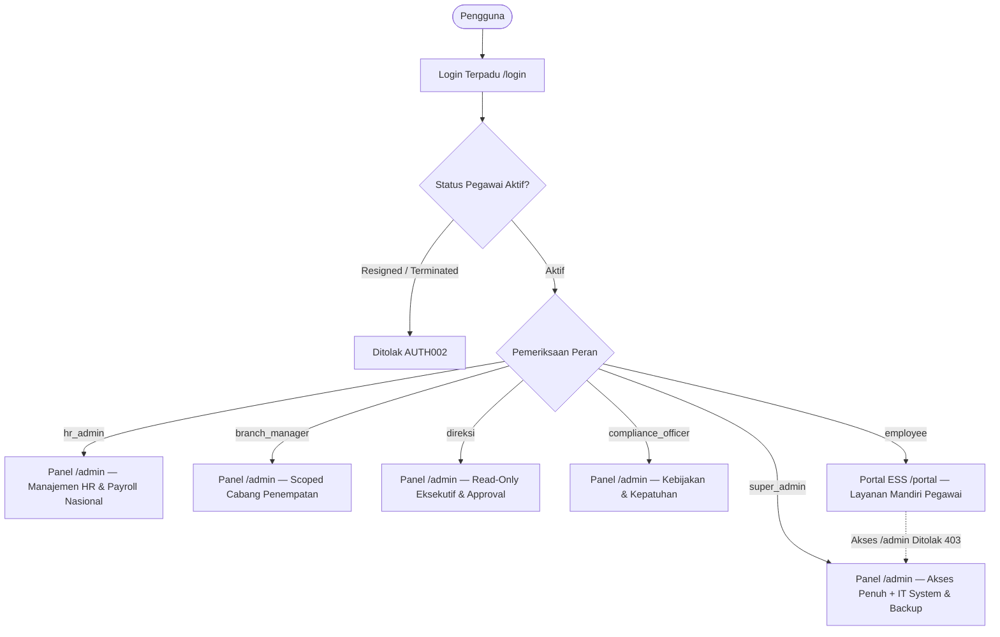
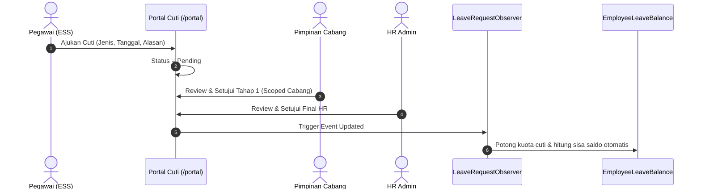

<div align="center">
  
  <br><br>
  <h1>Lara-HRIS — Core HRIS & Employee Self-Service (ESS)</h1>
  <p><strong>Sistem Informasi Manajemen Sumber Daya Manusia Terpadu PT Bank Perekonomian Rakyat Banda Raya</strong></p>

  [](https://laravel.com)
  [](https://filamentphp.com)
  [](https://php.net)
  [](https://m3.material.io)
  [-16A34A?style=for-the-badge&logo=checkmarx&logoColor=white)](tests/)
</div>

<p align="center">
  <a href="#-ringkasan-sistem">Ringkasan</a> •
  <a href="#-arsitektur-dual-panel--rbac">Arsitektur & RBAC</a> •
  <a href="#-modul--alur-kerja-utama">Modul & Alur Kerja</a> •
  <a href="#-keamanan-kepatuhan--failsafe">Keamanan & Failsafe</a> •
  <a href="#-panduan-instalasi--menjalankan-sistem">Instalasi</a> •
  <a href="#-pengujian-otomatis">Pengujian</a>
</p>

---

## 📌 Ringkasan Sistem

**Lara-HRIS** adalah platform *Human Resource Information System* (HRIS) internal **PT BPR Banda Raya** yang mengelola seluruh siklus hidup kepegawaian (*employee lifecycle*) dalam satu arsitektur **Dual-Panel**:

- **Backoffice HR & Eksekutif (`/admin`)** untuk manajemen data induk pegawai, jaringan cabang, persetujuan cuti & lembur, penggajian (*payroll*), mutasi karir, surat peringatan, rekrutmen IMAP, kepatuhan kebijakan, pencadangan data, serta pemantauan log sistem IT.
- **Employee Self-Service Portal (`/portal`)** untuk presensi GPS Geofencing harian, pengajuan cuti/lembur/reimbursement, akses slip gaji pribadi, katalog kebijakan kepatuhan, dan pembaruan profil kontak mandiri.

Antarmuka mengadopsi sistem desain **Material 3 Expressive** dengan dukungan penuh **Light & Dark Mode** beridentitas korporat perbankan:
- **Primary (Forest Green):** `#0E6838` (Light) / `#4ADE80` (Dark)
- **Secondary (Warm Orange):** `#EA580C` (Light) / `#FB923C` (Dark)
- **Tertiary (Golden Ribbon):** `#CA8A04` (Light) / `#FACC15` (Dark)

---

## 🏛️ Arsitektur Dual-Panel & RBAC



| Peran (`role`) | Panel | Cakupan Akses Utama |
| :--- | :---: | :--- |
| **`super_admin`** | `/admin` | Akses penuh seluruh modul HR, manajemen akun & role, **Backup Data (`/admin/backup-data`)**, **System Logs (`/admin/system-logs`)**, dan **Login Logs (`/admin/login-logs`)**. |
| **`hr_admin`** | `/admin` | Tata kelola data pegawai, absensi & dispensasi, approval final cuti, payroll, mutasi karir, SP, rekrutmen IMAP, dan pusat impor data CSV. |
| **`branch_manager`** | `/admin` | Monitoring pegawai dan persetujuan cuti/lembur tahap 1 khusus untuk kantor cabang penempatannya. |
| **`direksi`** | `/admin` | Tinjauan eksekutif (*read-only*) data kepegawaian dan persetujuan cuti tertentu sesuai kebijakan BPR. |
| **`compliance_officer`** | `/admin` | Pengelolaan katalog **Kebijakan & Kepatuhan (`/admin/compliance-policies`)** beserta target audiens dan status arsip. |
| **`employee`** | `/portal` | Presensi GPS Geofencing, riwayat kehadiran, pengajuan cuti/lembur/reimbursement, unduh slip gaji berstatus dibayar, katalog kepatuhan, dan profil mandiri. |

---

## 🔄 Modul & Alur Kerja Utama

### 1. Presensi Pintar (GPS Geofencing, Mesin Fingerprint & Dispensasi)
- **Presensi GPS Mandiri:** Validasi jarak koordinat pengguna terhadap titik kantor cabang penempatan menggunakan rumus *Haversine*. Presensi di luar radius ditolak otomatis dengan kode error `HR003`.
- **Integrasi Mesin Biometrik:** Dukungan impor log kehadiran dari mesin fingerprint (format `.xls`/`.csv` Solution/ZKTeco) melalui `/admin/attendances`.
- **Dispensasi Kehadiran:** Modul `/admin/attendance-dispensations` otomatis menyinkronkan status izin/dispensasi ke log presensi harian dan membebaskan penalti keterlambatan.

### 2. Pengajuan & Persetujuan Cuti Berjenjang (*Dual-Approval*)


### 3. Penggajian (*Payroll*) & Klaim Operasional
- **Batch Payroll (`/admin/payrolls`):** Kalkulasi otomatis komponen gaji pokok, tunjangan, lembur, dan potongan denda keterlambatan; pegawai hanya dapat melihat slip gaji miliknya yang berstatus dibayar di `/portal/payrolls`.
- **Lembur & Reimbursement:** Pengajuan klaim biaya operasional dan lembur terintegrasi dari Portal ESS menuju persetujuan Backoffice HR.

### 4. Siklus Karir, Disiplin & Kepatuhan
- **Mutasi & Promosi (`/admin/career-movements`):** Pembaruan cabang dan jabatan pegawai secara otomatis saat SK Karir diterbitkan, lengkap dengan pengelompokan riwayat per pegawai.
- **Surat Peringatan (`/admin/warning-letters`):** Penerbitan SP1, SP2, dan SP3 dengan masa berlaku otomatis.
- **Kebijakan & Kepatuhan (`/admin/compliance-policies`):** Distribusi dokumen kebijakan internal terarah (semua staf atau eksekutif) yang dapat diakses pegawai melalui `/portal/compliance-policies`.

### 5. Rekrutmen IMAP & Pusat Migrasi Data CSV
- **Rekrutmen cPanel IMAP (`/admin/job-applicants`):** Penarikan otomatis email lamaran dan ekstraksi lampiran CV (PDF/DOCX) langsung dari inbox `karir@bprbandaraya.com` melalui SSL/TLS tanpa membuka webmail.
- **Migrasi Data (`/admin/import-data`):** Impor massal data master pegawai dan log presensi dari CSV (mendukung pemisah `,` maupun `;` khas Excel Indonesia) lengkap dengan auto-create cabang/divisi/jabatan, akun `@bprbandaraya.com`, dan saldo cuti awal.

### 6. Pencadangan Data & IT System Logs Viewer
- **Backup Data (`/admin/backup-data`):** Khusus `super_admin` untuk membuat cadangan database atau arsip penuh ZIP (DB + dokumen storage) dengan penyamaran path sensitif server (`••••••••`).
- **System Logs (`/admin/system-logs`):** Khusus `super_admin` untuk memantau log error aplikasi langsung dari antarmuka web.

---

## 🛡️ Keamanan, Kepatuhan & Failsafe

1. **Perlindungan Autentikasi & Sesi:**
   - **Honeypot Trap** (`bpr_hp_verification`) untuk memblokir bot login otomatis (`SEC001`).
   - **Rate Limiter** (maksimal 5 percobaan gagal per menit, `AUTH005`) dan rekam jejak di `/admin/login-logs`.
   - **Blokir Otomatis Pegawai Non-Aktif:** Akun berstatus `Resigned` atau `Terminated` ditolak saat login (`AUTH002`) dan sesi aktifnya langsung dihentikan.
2. **HTTP Security Headers & RBAC Ketat:**
   - Header `X-Frame-Options: SAMEORIGIN`, `X-Content-Type-Options: nosniff`, `Referrer-Policy: strict-origin-when-cross-origin`, dan HSTS.
   - Kolom sensitif kepegawaian (NIP, NIK, Cabang, Status Kerja) bersifat *read-only* di Portal Pegawai.
3. **Standardisasi Kode Error & Halaman Error Terpadu (`App\Support\HrisErrorCode`):**
   - Seluruh error HTTP (`403`, `404`, `419`, `429`, `500`, `503`) dan exception domain memakai kode terstruktur (`DB001`–`DB005`, `AUTH001`–`AUTH005`, `SEC001`, `VAL001`, `HR001`–`HR004`, `SYS403`–`SYS500`) dengan tampilan custom tanpa dialog native browser (`alert`/`confirm`).
4. **Redundansi & Failsafe Logging:**
   - Channel `stack` menggabungkan `daily` (retensi 14 hari) dan `critical_archive` (`storage/logs/critical.log` khusus level `error`+, retensi 60 hari) dengan `ignore_exceptions => true` agar error penulisan log tidak menjatuhkan aplikasi.
   - `SystemLogs` membaca maksimal **256 KB** bagian akhir file (anti-OOM) dan menyamarkan path direktori server (`••••••••••••/storage/logs`).
   - **Scheduler Harian (`02:30` di `routes/console.php`):** Otomatis memangkas `LoginLog` > 180 hari dan memotong file `.log` yang melebihi `50 MB` agar hanya menyisakan `2 MB` terakhir.

---

## 🔑 Akun Demo Pengujian

> **Kata sandi default seluruh akun demo:** `password`

| Peran | Email Login | Panel Tujuan |
| :--- | :--- | :---: |
| **Super Admin (IT)** | `admin@bprbandaraya.com` | `/admin` |
| **HR Admin** | `hrd@bprbandaraya.com` / `ratna.dewi@bprbandaraya.com` | `/admin` |
| **Direksi** | `direksi@bprbandaraya.com` | `/admin` |
| **Pimpinan Cabang** | `pincab.botania@bprbandaraya.com` | `/admin` |
| **Pegawai (Teller / CS / AO)** | `teller.botania@bprbandaraya.com` / `cs.botania@bprbandaraya.com` | `/portal` |

---

## 🚀 Panduan Instalasi & Menjalankan Sistem

### 1. Prasyarat Lingkungan
- **PHP** `>= 8.2` (ekstensi: `pdo_sqlite` / `pdo_mysql`, `intl`, `mbstring`, `fileinfo`, `gd`, `zip`, `openssl`)
- **Composer** `>= 2.x`
- **Node.js & NPM** (untuk build aset frontend Vite/Tailwind)

### 2. Setup Awal
```bash
cd hris-system
composer run setup
php artisan migrate:fresh --seed
```

### 3. Menjalankan Server Pengembangan
```bash
cd hris-system
php artisan serve
```
Atau jalankan server, queue listener, log viewer, dan Vite secara bersamaan:
```bash
cd hris-system
composer run dev
```
Aplikasi dapat diakses melalui `http://127.0.0.1:8000` (atau domain lokal yang telah dikonfigurasi pada web server).

---

## 🧪 Pengujian Otomatis

Seluruh modul telah diverifikasi menggunakan PHPUnit (`tests/Feature` & `tests/Unit`):

```bash
cd hris-system
php artisan optimize:clear
php artisan test
```

```text
  Tests:    95 passed (564 assertions)
```

---

## 📄 Lisensi & Hak Cipta
Hak Cipta &copy; 2026 **PT Bank Perekonomian Rakyat Banda Raya**. Dilindungi Undang-Undang.
