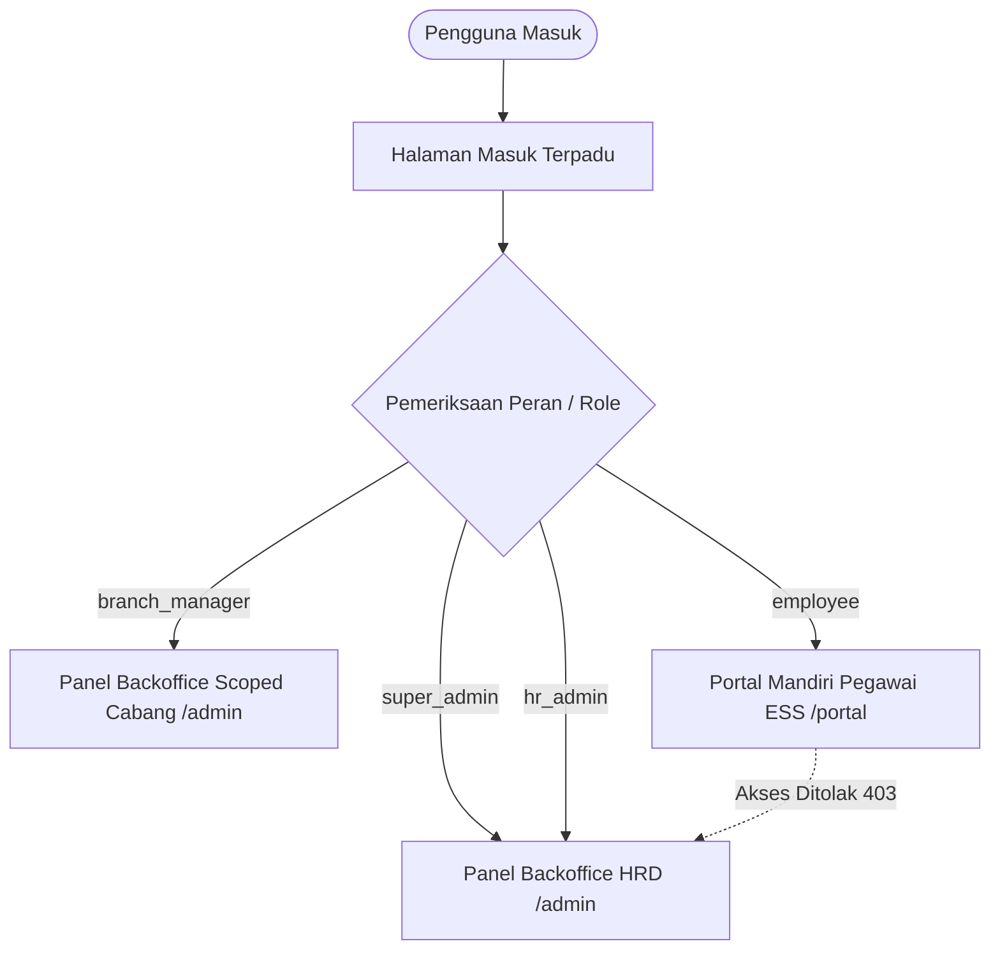
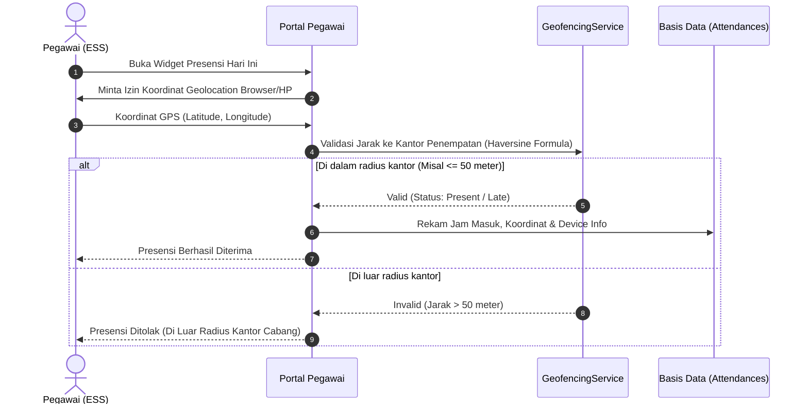
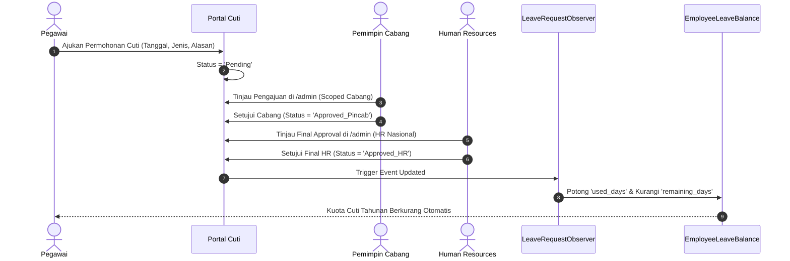
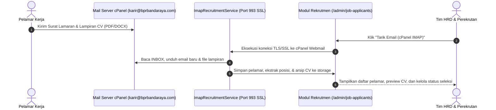
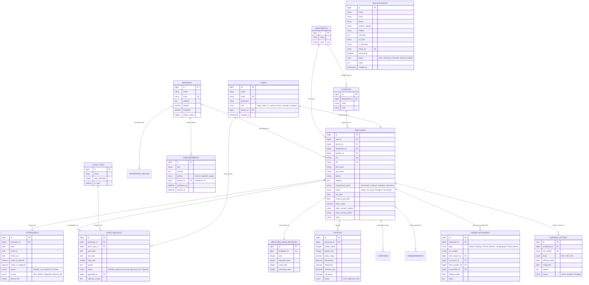

<div align="center">
  
  <br><br>
  <h1>Core HRIS & Employee Self-Service (ESS) Portal</h1>
  <p><strong>Sistem Informasi Manajemen Sumber Daya Manusia Terpadu PT Bank Perekonomian Rakyat Banda Raya</strong></p>

  [](https://laravel.com)
  [](https://filamentphp.com)
  [](https://php.net)
  [](https://m3.material.io)
  [-success?style=for-the-badge&logo=checkmarx&logoColor=white)](tests/)
</div>

---

## 📌 Ringkasan Sistem

**Core HRIS PT BPR Banda Raya** adalah platform enterprise terpadu untuk tata kelola siklus hidup kepegawaian (*employee lifecycle*), presensi pintar berbasis radius geofencing GPS, persetujuan cuti berjenjang, manajemen pergerakan karir & promosi, penegakan disiplin (Surat Peringatan), slip gaji (payroll) digital, klaim reimbursement, serta manajemen arsip cadangan data sistem.

Aplikasi dirancang dengan arsitektur **Dual-Panel (Backoffice HR & Portal Mandiri Karyawan)** dan mengadopsi standar **Material 3 Expressive Tonal Container**:
- 🌲 **Deep Emerald Green (`#0E6838`)** — Identitas korporat perbankan yang stabil, aman, dan berintegritas.
- 🍃 **Warm Sage-Mint (`#E8EFEA` / `#DFEAE2`)** — Ergonomi visual mode terang tanpa silau (*zero eye strain*) dengan rasio kontras tinggi.
- 🌑 **Slate-Emerald (`#0D1410` / `#141E18`)** — Mode gelap sejuk yang nyaman untuk mata saat bertugas malam.
- 📙 **Warm Orange (`#EA580C`)** & 🎗️ **Golden Amber (`#CA8A04`)** — Aksen indikator status operasional dan apresiasi kinerja.

---

## 🏛️ Arsitektur Dual-Panel & Hak Akses



| Panel | Rute URL | Akses Peran | Cakupan Fungsional |
| :--- | :--- | :--- | :--- |
| **Backoffice HR Panel** | `/admin` | Super Admin, HR Officer, Pimpinan Cabang (Pincab) | Tata kelola master cabang, departemen, jabatan, master pegawai, persetujuan cuti & klaim, surat peringatan, mutasi kerja, mesin fingerprint, payroll, dan pencadangan data sistem. |
| **Portal Mandiri Pegawai (ESS)** | `/portal` | Karyawan / Staf (Teller, CS, AO, Security, Umum) | Presensi GPS Geofencing harian, riwayat kehadiran, pengajuan cuti & lembur, slip gaji mandiri, dan pembaruan biodata kontak. |

---

## 🔄 Alur Proses Bisnis Utama (Core Workflows)

### 1. Alur Presensi Pintar & Geofencing GPS


### 2. Alur Pengajuan & Persetujuan Cuti Berjenjang (Dual-Approval)


### 3. Alur Pergerakan Karir (Mutasi & Promosi)
1. HR Admin menerbitkan SK Karir melalui modul `/admin/career-movements`.
2. Sistem menampilkan popup konfirmasi untuk mencegah kekeliruan nomor SK atau cabang penempatan.
3. Saat disimpan, sistem secara otomatis memperbarui relasi `branch_id` dan `position_id` pada profil pegawai terkait.

### 4. Alur Penegakan Disiplin (Surat Peringatan / SP)
1. Penerbitan SP1, SP2, atau SP3 dilakukan melalui `/admin/warning-letters` dilengkapi masa berlaku otomatis (6 bulan).
2. Surat peringatan terpantau secara transparan oleh HR Officer untuk evaluasi kontrak kerja berkala.

### 5. Alur Pencadangan & Kepatuhan Data (Backup Data)
1. Super Admin mengakses menu `/admin/backup-data`.
2. Memilih opsi **"Cadangkan Database Saja"** atau **"Cadangkan Arsip Lengkap (ZIP: DB + Berkas Dokumen)"**.
3. Sistem memunculkan popup konfirmasi otorisasi perbankan.
4. Arsip disimpan di `storage/app/backups/` dengan penamaan timestamp unik dan dapat diunduh langsung ke komputer lokal.

### 6. Alur Rekrutmen & Integrasi Email Masuk (cPanel IMAP)

1. **Otomatisasi Tanpa Buka Webmail**: Email pelamar yang masuk ke `karir@bprbandaraya.com` disedot langsung oleh sistem Lara-HRIS.
2. **Ekstraksi CV & Posisi Otomatis**: Sistem secara otomatis mengekstrak berkas lampiran (PDF/DOCX) ke direktori privat `storage/app/public/recruitment_cv` dan mendeteksi posisi yang dilamar dari subjek email.
### 7. Alur Migrasi & Impor Data Lama (Excel / CSV Migration Center)
1. **Menu Akses**: Super Admin dan HR Admin dapat mengakses menu `/admin/import-data` (Grup *Pengaturan & Sistem*).
2. **Template CSV Siap Unduh**:
   * **Template Master Pegawai**: Memuat kolom lengkap (`NIP`, `NIK`, `Nama_Lengkap`, `Email`, `Nomor_Telepon`, `Jenis_Kelamin`, `Tanggal_Lahir`, `Alamat`, `Kantor_Cabang`, `Divisi`, `Jabatan`, `Status_Kerja`, `Tanggal_Masuk`, `Nomor_Rekening`, dll) beserta contoh data valid.
   * **Template Log Presensi**: Memuat kolom (`NIP`, `Tanggal`, `Jam_Masuk`, `Jam_Keluar`, `Status`, `Catatan`) untuk memindahkan riwayat absensi dari mesin fingerprint lama (Solution, ZKTeco, dsb).
3. **Fitur Auto-Discovery & Smart Mapping Cerdas**:
   * **Auto-Create Organisasi**: Jika Cabang, Divisi, atau Jabatan dari file lama belum terdaftar di sistem, sistem otomatis membuatkannya.
   * **Auto-Generate Akun Login**: Akun pengguna (`User`) langsung dibuatkan otomatis dengan domain resmi `@bprbandaraya.com` dan kata sandi default `password`.
   * **Inisialisasi Kuota Cuti Otomatis**: Setiap pegawai baru yang diimpor langsung diberikan saldo kuota cuti tahunan (12 hari).
   * **Dukungan Format Excel Regional**: Sistem otomatis mendeteksi pemisah koma (`,`) maupun titik koma (`;`) yang biasa dihasilkan Microsoft Excel berbahasa Indonesia.

---

## 🗄️ Diagram Relasi Basis Data (Entity Relationship Diagram - ERD)



---

## 👥 Matriks Kasus Penggunaan (Use Case Matrix)

| Fitur / Modul | Staf Pegawai (ESS) | Pemimpin Cabang (Pincab) | HR Officer | Super Admin (IT) |
| :--- | :---: | :---: | :---: | :---: |
| **Login Mandiri & Ganti Tema** | ✅ | ✅ | ✅ | ✅ |
| **Presensi GPS Geofencing** | ✅ Mandiri | ❌ | ❌ | ❌ |
| **Lihat Riwayat & Slip Gaji** | ✅ Milik Sendiri | ❌ | ✅ Semua Pegawai | ✅ Semua Pegawai |
| **Pengajuan Cuti & Lembur** | ✅ Ajukan | ❌ | ❌ | ❌ |
| **Persetujuan Cuti Tahap 1 (Pincab)** | ❌ | ✅ Cabang Sendiri | ❌ | ❌ |
| **Persetujuan Final Cuti (HR)** | ❌ | ❌ | ✅ Nasional | ✅ Nasional |
| **Kelola Data Pegawai & Gaji** | ❌ | ❌ | ✅ Kelola | ✅ Kelola |
| **Terbitkan SP & Mutasi Karir** | ❌ | ❌ | ✅ Terbitkan | ✅ Terbitkan |
| **Kelola Master Cabang & Mesin** | ❌ | ❌ | ❌ | ✅ Kelola |
| **Backup & Unduh Arsip Sistem** | ❌ | ❌ | ❌ | ✅ Khusus Super Admin |

---

## 🛡️ Arsitektur Keamanan Siber (Security Hardening)

Lara-HRIS telah diperkuat dengan standar perlindungan perbankan berlapis:

1. **Honeypot Trap:**
   Formulir login dilengkapi input tersembunyi `bpr_hp_verification`. Bot/scraper otomatis yang mengisi kolom ini langsung digagalkan tanpa respons error verbose.
2. **Login Rate Limiter:**
   Membatasi maksimal 5 percobaan login gagal berturut-turut per menit. Melindungi akun dari serangan kamus dan *brute-force dictionary attacks*.
3. **HTTP Security Headers Lengkap:**
   - `X-Frame-Options: SAMEORIGIN` (Mencegah serangan *Clickjacking* / pencurian klik).
   - `X-Content-Type-Options: nosniff` (Mencegah eksploitasi interpretasi tipe berkas MIME).
   - `X-XSS-Protection: 1; mode=block` (Mencegah serangan skrip lintas situs).
   - `Strict-Transport-Security` (HSTS: Memaksa koneksi HTTPS terenkripsi).
   - `Referrer-Policy: strict-origin-when-cross-origin` (Melindungi privasi rujukan URL).
4. **Isolasi Panel & Hak Akses (RBAC):**
   - Karyawan staf non-admin otomatis diblokir saat mencoba mengakses rute `/admin` (HTTP 403 Forbidden).
   - Akun Super Admin langsung dialihkan (*redirect*) ke panel administrasi `/admin`.
   - Modul pencadangan data (`/admin/backup-data`) dilindungi verifikasi eksplisit `canAccess(): bool`.
5. **Modal Konfirmasi Berdampak Tinggi:**
   Penyimpanan profil, perubahan rekening, persetujuan pemotongan cuti, penerbitan SP, SK mutasi, dan pencadangan database wajib melalui dialog konfirmasi persetujuan sadar pengguna (*conscious consent modal*).
6. **Integritas Audit Trail:**
   Kolom data formal kepegawaian (NIP, NIK, Cabang, Status Karyawan) dikunci *read-only* pada Portal Pegawai untuk menjamin integritas rekam jejak audit OJK/Bank Indonesia.

---

## 🔑 Kredensial Pengujian (Demo Accounts)

> **Kata sandi default untuk seluruh akun demo:** `password`

| Peran | Nama Pegawai | Email Login | Hak Akses |
| :--- | :--- | :--- | :--- |
| **Super Admin** | Administrator Sistem | `admin@bprbandaraya.com` | `/admin` (Akses Penuh + Backup) |
| **HR Officer** | Ratna Dewi, S.Psi | `ratna.dewi@bprbandaraya.com` | `/admin` (Manajemen HR Nasional) |
| **Pincab Botania** | Hendra Kurniawan | `pincab.botania@bprbandaraya.com` | `/admin` (Khusus Cabang Botania) |
| **Teller Botania** | Siti Rahma | `teller.botania@bprbandaraya.com` | `/portal` (Portal Mandiri Pegawai) |
| **CS Botania** | Budi Santoso | `cs.botania@bprbandaraya.com` | `/portal` (Portal Mandiri Pegawai) |
| **AO Botania** | Fajar Nugraha | `fajar.nugraha@bprbandaraya.com` | `/portal` (Portal Mandiri Pegawai) |

---

## 🚀 Panduan Menjalankan Sistem

### 1. Prasyarat Lingkungan
- PHP >= 8.2 (ekstensi: `pdo_sqlite`, `intl`, `mbstring`, `fileinfo`, `gd`, `zip`, `openssl`)
- Composer >= 2.x
- Web Browser modern (Chrome, Edge, Firefox, Safari)

### 2. Cara Menjalankan Server
```bash
# Cara Praktis (Rekomendasi di Windows):
# Jalankan start.bat di folder utama proyek
..\start.bat
```
Menu interaktif otomatis menguji port `8000`, menjalankan background task worker, dan menampilkan log realtime dengan opsi matikan server bersih `[X]`.

Atau via command prompt manual:
```bash
cd hris-system
php artisan serve
```
Akses di peramban: **`http://127.0.0.1:8000`**

---

## 🧪 Hasil Pengujian Otomatis (Automated Tests)

Seluruh modul telah diuji dengan **23 Test Suites (141 Assertions)** tanpa kegagalan:

```bash
php artisan test
```

```text
   PASS  Tests\Unit\ExampleTest
   PASS  Tests\Feature\BackupTest
   PASS  Tests\Feature\ComprehensiveResourceTest
   PASS  Tests\Feature\ExampleTest
   PASS  Tests\Feature\HrisTest
   PASS  Tests\Feature\PanelRoutesTest
   PASS  Tests\Feature\SecurityTest

  Tests:    23 passed (141 assertions)
  Duration: 100% Pass
```

---

## 📄 Lisensi & Hak Cipta
Hak Cipta &copy; 2026 **PT Bank Perekonomian Rakyat Banda Raya**. Dilindungi Undang-Undang.
