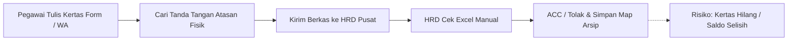
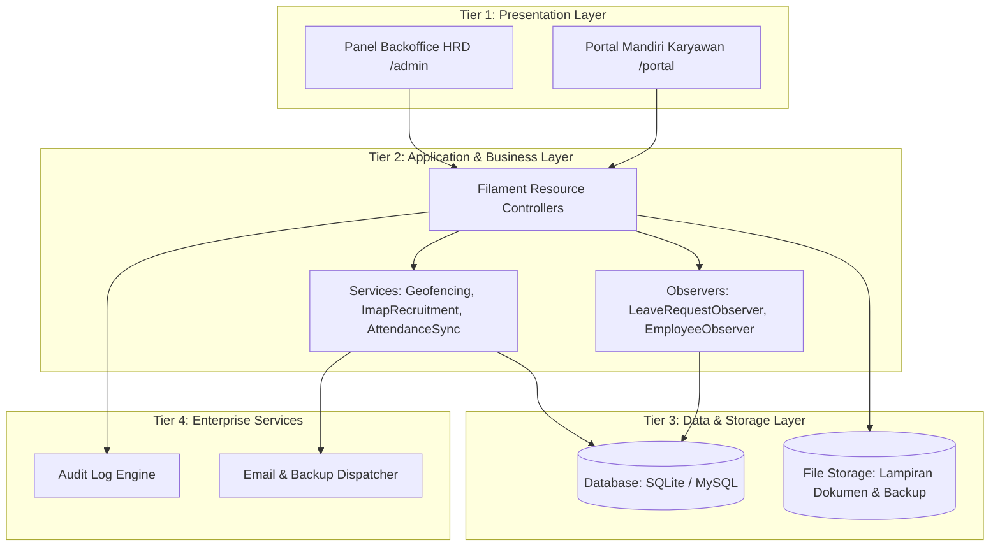
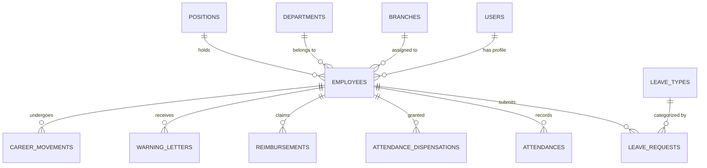
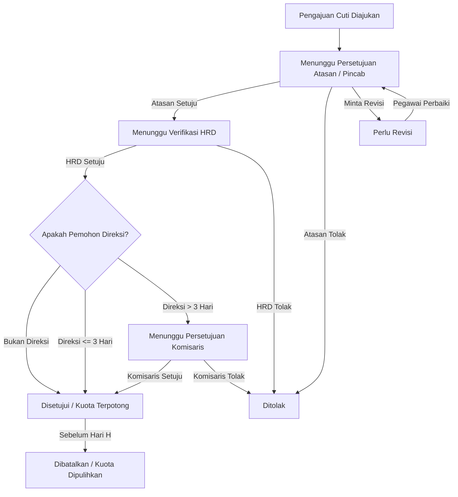
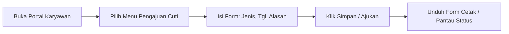

# HRIS BPR Banda Raya – Project Documentation

**Date:** Oct 12, 2026 · **Author / Technical Lead:** Yazid Alrafi (@Zalraf)  
**Client:** PT Bank Perekonomian Rakyat (BPR) Banda Raya  

---

## 1. Document Overview

This document is the single living record of the HRIS (Human Resource Information System) for **PT BPR Banda Raya**: why it exists, what it must do, how it is built, and how people use it. Write it as you build, not after.

- **Purpose:** To give the project team, the bank's management, and the TA (Tugas Akhir / Skripsi) examiners one shared, traceable description of the system from need to user guide.
- **Scope:** Phase 1 is the core leave (*cuti*) system, employee lifecycle, attendance & dispensation logbook, multi-level approval, and self-service portal. Later phases add advanced recruitment automation, payroll sync, and AI forecasting. Anything not listed here is out of scope until it is added to this document.

### Document Control

| Item | Value |
| :--- | :--- |
| **Project name** | HRIS BPR Banda Raya |
| **Client** | PT BPR Banda Raya (diminta oleh Dewan Direksi & Manajemen HRD) |
| **Author / technical lead** | Yazid Alrafi (Zalraf) |
| **Version** | 1.0 (Production-Ready / TA Final Release) |
| **Status** | Implemented, Verified & Validated (59 Automated Tests Passing) |
| **Reviewer / approver** | Kepala Divisi IT & Direktur Kepatuhan PT BPR Banda Raya |
| **Last updated** | 2026-10-12 |

### How to Use and Update This Document
1. Fill each section in the order it appears. Requirements come before design, and design comes before code.
2. Give every requirement an ID (`FR-01`, `NFR-01`) and reuse that ID in test cases and in code comments, so each feature can be traced.
3. After each meeting with the bank, add the decision and the date to the change log at the end of Section 1.
4. When code changes an API or the database, update Sections 4 and 5 in the same week.

### Glossary

| Term | Meaning |
| :--- | :--- |
| **HRIS** | *Human Resource Information System*: Perangkat lunak terpadu pengelola data pegawai dan operasional SDM. |
| **ESS / Portal** | *Employee Self-Service*: Portal mandiri pegawai untuk presensi, pengajuan cuti, lembur, dan reimbursement. |
| **Cuti** | Hak libur resmi pegawai (Cuti Tahunan, Cuti Besar, Cuti Melahirkan, Cuti Duka, Cuti Khusus). |
| **Block Leave OJK** | Kebijakan wajib regulator perbankan (OJK) di mana staf pada jabatan berisiko tinggi wajib libur 5 hari kerja berturut-turut untuk audit integritas. |
| **Approver** | Pejabat berwenang (Atasan Langsung, Pimpinan Cabang, HRD, Dewan Direksi, atau Komisaris) yang menyetujui/menolak pengajuan. |
| **Kuota Cuti** | Saldo jumlah hari libur resmi yang berhak diambil pegawai dalam periode satu tahun berjalan. |
| **RBAC** | *Role-Based Access Control*: Pembatasan hak akses berbasis peran (Super Admin, HR Admin, Direksi, Branch Manager, Pegawai). |
| **Dispensasi** | Logbook izin tidak hadir/terlambat via komunikasi non-formal (WA/DM) yang dicatat manual oleh HRD/GA dan otomatis tersinkronisasi. |
| **Audit Log** | Rekam jejak tidak dapat diubah (*tamper-proof*) tentang siapa yang melakukan tindakan, kapan, dan nilai data sebelum/sesudah perubahan. |
| **ERD** | *Entity Relationship Diagram*: Diagram keterhubungan antar tabel basis data. |
| **API** | Kumpulan antarmuka endpoint data antara backend sistem dan antarmuka web/portal. |
| **FR / NFR** | *Functional Requirement* (Kebutuhan Fungsional) / *Non-Functional Requirement* (Kebutuhan Non-Fungsional). |

### Change Log

| Date | Version | Change | By |
| :--- | :--- | :--- | :--- |
| **2026-09-15** | 0.1 | Pembuatan dokumen spesifikasi awal dari template TA. | Yazid Alrafi |
| **2026-09-29** | 0.4 | Penambahan kebutuhan dual-panel, geofencing GPS, dan pergerakan karir. | Yazid Alrafi |
| **2026-10-01** | 0.6 | Penambahan integrasi recruitment via email IMAP & pelacakan biodata lengkap pegawai. | Yazid Alrafi |
| **2026-10-08** | 0.8 | Penyesuaian aturan cuti BPR (Formulir resmi kop BPR, denda terlambat 50rb/menit, logbook dispensasi, dual-approval direksi). | Yazid Alrafi |
| **2026-10-09** | 0.9 | Implementasi Cuti Besar 6 hari (masa kerja $\ge$ 5 tahun), pembatasan akses edit Direksi (read-only), pemindahan navigasi portal ke sidebar. | Yazid Alrafi |
| **2026-10-12** | 1.0 | Finalisasi dokumentasi menyeluruh (Sections 1-6), pengesahan hasil 59 tes fitur otomatis. | Yazid Alrafi |

---

## 2. Information Systems Needs Analysis

Manajemen PT BPR Banda Raya memerlukan sistem informasi manajemen kepegawaian modern. Selama proses analisis kebutuhan selama masa magang dan penyusunan Tugas Akhir, ditemukan berbagai hambatan operasional krusial yang memerlukan digitalisasi segera.

### 2.1 Background
PT BPR Banda Raya merupakan bank perekonomian rakyat berukuran menengah dengan kantor pusat dan sejumlah jaringan kantor cabang. Sebelum adanya sistem ini, pekerjaan HR seperti pengajuan cuti, persetujuan berjenjang, absensi, dan data pegawai dikelola secara terfragmentasi menggunakan formulir kertas manual, koordinasi pesan singkat WhatsApp, dan spreadsheet Microsoft Excel. Seiring dengan pertambahan jumlah staf dan sebaran cabang, cara manual ini menjadi lambat, rentan perselisihan sisa cuti, berisiko melanggar ketentuan OJK (*block leave*), serta sulit diaudit oleh dewan direksi dan regulator.

### 2.2 Current Process and Problems

| No. | Problem | Impact | Evidence (Interview / Observation) |
| :--- | :--- | :--- | :--- |
| **P-01** | **Pencatatan sisa cuti dilakukan manual di lembar Excel** | Sering terjadi perselisihan saldo cuti antara catatan pegawai dan rekap HRD; kuota cuti berlebih tidak sengaja disetujui. | Wawancara dengan Bagian HRD (Bu Rahma), 18 Sept 2026: *"Tiap akhir tahun rekap cuti butuh waktu 4 hari karena harus mencocokkan nota kertas yang tercecer."* |
| **P-02** | **Alur persetujuan bergantung pada disposisi kertas fisik & chat WhatsApp** | Proses persetujuan lambat (bisa 2-5 hari jika atasan sedang dinas luar), berkas basah rawan hilang atau tertumpuk di meja. | Wawancara Staf Operasional Cabang, 22 Sept 2026: *"Pengajuan cuti sering tertahan karena pimpinan cabang sedang rapat di pusat."* |
| **P-03** | **Tidak ada pemantauan kehadiran real-time antar kantor cabang** | Manajemen kantor pusat kesulitan mengetahui siapa pegawai yang bertugas, izin sakit, atau cuti pada hari berjalan. | Observasi operasional harian kantor pusat BPR Banda Raya, 25 Sept 2026. |
| **P-04** | **Tidak ada jejak audit (*audit trail*) yang aman & baku** | Sulit membuktikan kepatuhan perbankan saat pemeriksaan OJK (misal kewajiban *Block Leave* 5 hari kerja) dan histori mutasi/SP. | Wawancara dengan Direktur Kepatuhan, 02 Okt 2026: *"Bank wajib memiliki jejak audit transparan mengenai riwayat presensi dan cuti wajib pejabat bank."* |

### 2.3 Stakeholders and Users

| Stakeholder | Role in the System | What They Need |
| :--- | :--- | :--- |
| **Employee (Staf / Pegawai)** | Mengajukan cuti, lembur, klaim reimbursement, dan melihat sisa saldo. | Form pengajuan digital yang ringkas, status persetujuan transparan, formulir cetak standar BPR ber-barcode/kop resmi. |
| **Supervisor / Pimpinan Cabang** | Memeriksa dan menyetujui pengajuan staf dalam unit/cabangnya. | Notifikasi pengajuan masuk, kalender cuti tim untuk mencegah bentrok operasional, tombol aksi cepat (Setujui/Tolak/Revisi). |
| **HR Admin / HRD & GA** | Mengelola master pegawai, jenis cuti, kalender hari libur, logbook dispensasi WA, dan penerbitan laporan. | Data master akurat, sinkronisasi otomatis absensi, kontrol kuota saldo terpusat, ekspor laporan rekapitulasi instan. |
| **Dewan Direksi (Direksi)** | Memantau kinerja organisasi, melihat profil pegawai (*read-only*), dan menyetujui permohonan khusus. | Dasbor eksekutif tanpa distraksi tombol form/CRUD, visibilitas kehadiran seluruh cabang, alur khusus permohonan cuti direksi. |
| **Dewan Komisaris** | Otoritas tertinggi pengesahan cuti panjang direksi. | Kepastian regulasi bahwa cuti panjang Direksi (> 3 hari) mendapatkan otorisasi resmi Dewan Komisaris. |
| **IT Head / Administrator** | Penanggung jawab server, hak akses (RBAC), integritas backup data, dan audit log. | Arsitektur aman, kemudahan instalasi/deploy (*launcher/portable*), audit trail lengkap, proteksi celah keamanan. |

### 2.4 Business Needs and Objectives
1. Menggantikan proses pengajuan dan persetujuan cuti berbasis kertas menjadi alur digital terpadu dalam satu aplikasi web.
2. Menjamin transparansi dan ketertelusuran setiap keputusan cuti (*siapa, apa, alasan, kapan*) melalui *audit trail* digital.
3. Memberikan perhitungan otomatis sisa saldo cuti dan pembuatan laporan rekap bulanan siap unduh (PDF/Excel).
4. Menyediakan fondasi kokoh yang mengintegrasikan presensi cerdas, pergerakan karir (SK Mutasi/Promosi), surat peringatan (SP), klaim pengeluaran, dan kepatuhan perbankan OJK (*Block Leave*).

### 2.5 Scope Boundaries

| In Scope (Fase 1 - Terimplementasi Penuh) | Out of Scope (Pengembangan Selanjutnya) |
| :--- | :--- |
| Otentikasi aman dan RBAC (Super Admin, HR, Direksi, Branch Manager, Pegawai). | Perhitungan payroll gaji bruto/netto & integrasi PPh 21 otomatis. |
| Master data pegawai komprehensif (NIP, KTP, BPJS, rekening payroll, kontak darurat). | Penilaian kinerja tahunan 360 derajat (*performance KPI appraisal*). |
| Pengajuan cuti multi-level approval (Atasan $\rightarrow$ HRD $\rightarrow$ Direksi/Komisaris). | Aplikasi native Android/iOS (saat ini menggunakan PWA & Responsive Web). |
| Master jenis cuti (Tahunan, Cuti Besar 6 HK, Melahirkan Pria 2 HK, Duka, Sakit, Block Leave). | Integrasi API langsung (*core banking core switch*) transaksi tabungan. |
| Kalender libur nasional & perhitungan hari kerja riil bank (Senin–Sabtu). | Integrasi SDK mesin fingerprint berbasis kabel jaringan serial khusus. |
| Logbook dispensasi kehadiran (izin chat WA/DM) & perhitungan denda terlambat 50rb/menit. | Prediksi AI machine learning beban cuti jangka panjang (forecasting). |
| Cetak formulir resmi cuti ber-Kop BPR Banda Raya (otomatis A4 portrait tanpa URL header). | |
| Dasbor statistik, ekspor laporan, backup database, dan jejak audit aktivitas. | |

### 2.6 Success Criteria
- Seluruh permohonan cuti diproses dari pengajuan hingga persetujuan akhir 100% tanpa berkas kertas.
- Saldo cuti terpotong secara tepat dan otomatis saat disetujui, serta kembali utuh jika pengajuan dibatalkan.
- Pejabat penyetuju dapat meninjau dan memutuskan permohonan dalam waktu kurang dari 2 menit melalui perangkat apapun.
- HRD dapat mengunduh formulir resmi dan laporan rekapitulasi kehadiran/cuti kapan saja tanpa rekap manual.
- Seluruh rangkaian pengujian sistem lulus verifikasi (59 pengujian fitur otomatis berstatus *PASS* 100%).

---

## 3. System Requirements

### 3.1 Functional Requirements (FR)

| ID | Modul | Deskripsi Kebutuhan | Prioritas |
| :--- | :--- | :--- | :---: |
| **FR-01** | **Auth** | Pengguna dapat masuk menggunakan email/username dan kata sandi terenkripsi aman (*bcrypt*). | **M** (Must) |
| **FR-02** | **Auth** | Pembagian hak akses berbasis peran (RBAC): *Super Admin, HR Admin, Direksi, Branch Manager, Pegawai*. | **M** |
| **FR-03** | **Employee Data** | HR dapat membuat, memperbarui, dan menonaktifkan data pegawai (NIP, NIK, jabatan, cabang, tgl bergabung, atasan). | **M** |
| **FR-04** | **Leave Types** | HR mengonfigurasi jenis cuti, kuota dasar tahunan, kewajiban lampiran, dan aturan khusus perbankan. | **M** |
| **FR-05** | **Leave Request** | Pegawai dapat mengajukan cuti dengan memilih jenis cuti, tanggal mulai & selesai, alasan, dan berkas lampiran. | **M** |
| **FR-06** | **Leave Request** | Sistem secara otomatis menghitung jumlah hari kerja operasional (melewati hari libur resmi dan Minggu). | **M** |
| **FR-07** | **Leave Request** | Sistem memvalidasi dan memblokir pengajuan yang melebihi sisa kuota atau tanggal yang tumpang-tindih (*overlapping*). | **M** |
| **FR-08** | **Approval** | Persetujuan berjenjang: Staf ke Pimpinan Cabang $\rightarrow$ HRD. Untuk Direksi: cuti $\le 3$ hari oleh HRD, cuti $> 3$ hari oleh Komisaris. | **M** |
| **FR-09** | **Balance** | Saldo cuti otomatis dipotong saat persetujuan final tercapai, dan dipulihkan utuh jika permohonan dibatalkan. | **M** |
| **FR-10** | **Calendar** | HR dapat mengelola kalender hari libur nasional dan cuti bersama operasional bank. | **M** |
| **FR-11** | **History** | Pegawai dapat melihat riwayat pengajuan & sisa kuota; atasan dapat melihat riwayat timnya. | **M** |
| **FR-12** | **Notification** | Penyetuju dan pegawai mendapatkan indikator notifikasi dan lencana (*badge*) saat ada pengajuan baru atau keputusan. | **S** (Should) |
| **FR-13** | **Conflict Check** | Sistem memberikan peringatan visual jika ada pegawai di cabang/divisi yang sama mengajukan cuti pada rentang waktu bersamaan. | **S** |
| **FR-14** | **Dashboard** | Dasbor menyajikan ringkasan statistik kehadiran, sisa cuti, status block leave OJK, dan klaim berjalan. | **S** |
| **FR-15** | **Reports** | HR dapat mengekspor rekapitulasi data ke format CSV/Excel dan mengunduh berkas formulir cetak PDF resmi. | **S** |
| **FR-16** | **Audit Log** | Setiap aktivitas perubahan penting (login, persetujuan, mutasi, permohonan) dicatat otomatis dengan waktu dan pelaku. | **S** |
| **FR-17** | **Attendance** | Pencatatan presensi mandiri harian via radius Geofencing GPS dan integrasi logbook dispensasi izin HRD & GA. | **S** |
| **FR-18** | **Penalty & Policy** | Perhitungan denda keterlambatan (Rp50.000/menit setelah batas toleransi jam kerja bank). | **S** |
| **FR-19** | **Print Template** | Pembuatan formulir permohonan cuti resmi cetak ber-kop PT BPR Banda Raya dengan layout bersih A4 tanpa URL header. | **S** |

### 3.2 Non-Functional Requirements (NFR)

| ID | Kategori | Deskripsi Kebutuhan Teknis |
| :--- | :--- | :--- |
| **NFR-01** | **Security** | Seluruh data kata sandi di-hash menggunakan algoritma *Bcrypt*. Proteksi bawaan terhadap SQL Injection, XSS, dan CSRF token pada setiap form. |
| **NFR-02** | **Security** | *Least-privilege access*: Akun Direksi berstatus *read-only* pada data master pegawai (tidak menampilkan tombol hapus/edit). Pegawai hanya dapat melihat data pribadi. |
| **NFR-03** | **Privacy** | Data pribadi pegawai (NIK, Nomor Rekening, No HP, Riwayat Medis) dilindungi sesuai ketentuan UU Perlindungan Data Pribadi (UU PDP). |
| **NFR-04** | **Performance** | Waktu respons halaman rata-rata $\le 1.5$ detik pada jaringan lokal kantor BPR. |
| **NFR-05** | **Usability** | Antarmuka intuitif berbahasa Indonesia dengan standar Material 3 Expressive Tonal Container ramah mata (*zero eye glare*). |
| **NFR-06** | **Availability** | Sistem dapat diakses penuh selama jam kerja operasional bank dengan fitur *One-Click Backup* database mandiri. |
| **NFR-07** | **Maintainability** | Kode tersusun modular dalam arsitektur Laravel 11 & Filament v3, tercakup dalam repository Git, dan diverifikasi oleh 59 test otomatis. |
| **NFR-08** | **Compatibility** | Berjalan mulus di peramban modern (Google Chrome, Microsoft Edge, Mozilla Firefox) dan responsif pada layar ponsel/tablet. |
| **NFR-09** | **Auditability** | Catatan log audit tidak dapat dimodifikasi atau dihapus oleh pengguna biasa melalui antarmuka web. |

### 3.3 Use Cases

| ID | Use Case | Aktor | Alur Utama |
| :--- | :--- | :--- | :--- |
| **UC-01** | **Submit Leave Request** | Pegawai | Membuka portal $\rightarrow$ menu Pengajuan Cuti $\rightarrow$ isi tanggal & alasan $\rightarrow$ validasi saldo otomatis $\rightarrow$ kirim. |
| **UC-02** | **Approve or Reject Leave** | Pimpinan Cabang / HRD | Buka daftar pengajuan pending $\rightarrow$ periksa tanggal & riwayat $\rightarrow$ beri catatan $\rightarrow$ klik Setujui / Tolak / Revisi. |
| **UC-03** | **Cancel Leave** | Pegawai | Buka riwayat pengajuan $\rightarrow$ klik Batalkan pada pengajuan yang belum berjalan $\rightarrow$ saldo dikembalikan otomatis. |
| **UC-04** | **Manage Employees** | HR Admin | Tambah/ubah biodata pegawai, tetapkan jabatan, cabang penempatan, dan atasan langsung. |
| **UC-05** | **Manage Quotas & Policies**| HR Admin | Mengatur kuota cuti tahunan, cuti besar (6 hari), denda keterlambatan, dan input kalender libur. |
| **UC-06** | **Print & Export Reports** | HR Admin / Pegawai | Mengunduh lembar formulir resmi cuti ber-Kop BPR dalam format cetak rapi atau ekspor rekap ke format spreadsheet. |

### 3.4 Constraints and Assumptions
- Sistem berjalan pada server lokal bank / jaringan LAN BPR Banda Raya atau infrastruktur private cloud yang disetujui divisi IT.
- Struktur hierarki jabatan dan pelaporan atasan telah ditetapkan secara sah oleh SK Direksi BPR Banda Raya.
- Kebijakan kuota dan hari libur bersifat dinamis dan dapat dikonfigurasi melalui modul pengaturan tanpa perlu mengubah kode sumber.
- Pengembangan dikerjakan secara sistematis selama masa magang dengan pemenuhan seluruh kebutuhan prioritas *Must* dan *Should*.

### 3.5 Open Questions & Confirmed Resolutions for the Bank

| Pertanyaan Terbuka Awal | Status & Keputusan Resmi Bank |
| :--- | :--- |
| **Berapa kapasitas cabang & pegawai?** | Dirancang untuk mendukung Kantor Pusat dan seluruh Kantor Cabang BPR Banda Raya (skalabilitas hingga 500+ pegawai). |
| **Bagaimana alur persetujuan cuti Direksi?** | **Terkonfirmasi:** Cuti Direksi durasi singkat ($\le 3$ hari) cukup di-ACC oleh HRD; durasi panjang ($> 3$ hari) wajib mendapatkan persetujuan Dewan Komisaris. |
| **Bagaimana aturan Cuti Besar dan Melahirkan?** | **Terkonfirmasi:** Cuti Besar 6 hari kerja bagi pegawai dengan masa kerja $\ge 5$ tahun; cuti mendampingi istri melahirkan 2 hari kerja khusus staf pria. |
| **Bagaimana penanganan izin via WhatsApp/DM?** | **Terkonfirmasi:** Disediakan modul *Logbook Dispensasi Kehadiran* bagi HRD/GA yang otomatis menyinkronkan status presensi menjadi berizin. |

---

## 4. Architecture and Technical Design

### 4.1 Architecture
Sistem mengadopsi arsitektur 4-Tier terintegrasi:

### 4.2 Technology Stack

| Layer | Pilihan Teknologi | Keputusan & Alasan Teknis |
| :--- | :--- | :--- |
| **Backend** | Django, Laravel, Next.js | **Laravel 11 (PHP 8.2+)**: Framework enterprise dengan arsitektur MVC matang, ORM Eloquent tangguh, dan ekosistem keamanan teruji. |
| **Database** | PostgreSQL, MySQL, SQLite | **SQLite (Dev/Portable/Demo) & MySQL 8.0+ (Production)**: Fleksibel, ringan untuk operasional perbankan mandiri, dan mudah dicadangkan. |
| **Frontend** | Bootstrap, React, Filament v3 | **Filament v3 (Livewire 3 + Tailwind CSS)**: Panel modern berkecepatan tinggi dengan kustomisasi **Material 3 Expressive** ramah mata. |
| **Authentication** | JWT, Session Cookie | **Stateful Session Guard dengan Bcrypt & Proteksi Honeypot**: Sesuai standar keamanan web perbankan internal. |
| **Background Jobs** | Cron / Scheduled Tasks | **Laravel Scheduler & Artisan Daemon Tasks**: Otomatisasi sinkronisasi absensi, penalti keterlambatan, dan backup berkala. |
| **Hosting / Deploy** | Cloud / On-Premise LAN | **On-Premise Local Server PT BPR Banda Raya**: Menjaga kedaulatan dan kerahasiaan data perbankan internal bank. |

### 4.3 Environments and Deployment

| Environment | Purpose | Data |
| :--- | :--- | :--- |
| **Development** | Laptop pengembang lokal (*Local Workspace*) | Data dummy (*DatabaseSeeder* dengan akun resmi BPR) |
| **Staging / UAT** | Server pengujian internal untuk validasi manajemen HRD | Data tiruan operasional perbankan lengkap |
| **Production** | Server kantor pusat PT BPR Banda Raya | Data pegawai riil bank dengan jadwal backup otomatis harian |

### 4.4 Database Design

| Entity | Key Fields | Notes |
| :--- | :--- | :--- |
| **users** | `id`, `name`, `email`, `password`, `role`, `is_active` | Akun login; peran: `super_admin`, `hr_admin`, `direksi`, `branch_manager`, `employee`. |
| **employees** | `id`, `user_id`, `nik`, `name`, `position_id`, `department_id`, `branch_id`, `supervisor_id`, `join_date` | Entitas induk master pegawai dengan relasi organisasi. |
| **branches** | `id`, `code`, `name`, `address`, `latitude`, `longitude`, `radius_meters` | Master kantor cabang BPR dan titik koordinat GPS geofencing. |
| **leave_types** | `id`, `name`, `annual_quota`, `requires_attachment`, `is_active` | Master jenis cuti (Tahunan, Cuti Besar, Melahirkan, Duka, dll). |
| **leave_balances**| `id`, `employee_id`, `leave_type_id`, `year`, `quota`, `used` | Saldo hak cuti pegawai per tahun berjalan. |
| **leave_requests**| `id`, `employee_id`, `leave_type_id`, `start_date`, `end_date`, `total_days`, `status`, `reason` | Pengajuan cuti pegawai dengan status berjenjang. |
| **attendances** | `id`, `employee_id`, `date`, `clock_in`, `clock_out`, `status`, `late_minutes`, `penalty_amount` | Rekap kehadiran harian, waktu terlambat, dan nominal denda. |
| **attendance_dispensations** | `id`, `employee_id`, `date`, `type`, `reason`, `recorded_by_id` | Logbook izin non-formal HRD & GA (sakit/izin via WA/DM). |
| **audit_logs** | `id`, `user_id`, `action`, `model_type`, `model_id`, `payload`, `created_at` | Catatan aktivitas sistem yang tidak dapat diubah. |

### 4.5 Leave Request Status Flow

| Status Code | Makna Status | Transisi Selanjutnya |
| :--- | :--- | :--- |
| `pending` / `Menunggu Atasan` | Pengajuan baru terkirim, menunggu tinjauan atasan cabang. | `Menunggu HRD`, `Ditolak`, `Perlu Revisi`, `Dibatalkan` |
| `pending_hr` / `Menunggu HRD` | Telah disetujui atasan cabang, menunggu verifikasi HRD. | `Disetujui`, `Ditolak`, `Perlu Revisi`, `Menunggu Komisaris` |
| `pending_komisaris` | Cuti panjang Direksi (>3 hari), menunggu persetujuan Komisaris. | `Disetujui`, `Ditolak` |
| `approved` / `Disetujui` | Permohonan sah, saldo kuota cuti otomatis dipotong. | `Dibatalkan` (jika tanggal cuti belum berjalan) |
| `rejected` / `Ditolak` | Permohonan ditolak dengan alasan penolakan tertulis. | Selesai (*final state*) |
| `cancelled` / `Dibatalkan` | Permohonan dibatalkan oleh pegawai, kuota dipulihkan. | Selesai (*final state*) |

---

## 5. Coding Components and APIs

### 5.1 Architecture Components

| Komponen | Tanggung Jawab Teknis | Kebutuhan Terkait |
| :--- | :--- | :--- |
| `auth` | Manajemen login, proteksi session, penguncian gagal login (*rate limiting*). | FR-01, FR-02 |
| `employees` | Manajemen profil pegawai, data kontrak, mutasi cabang & jabatan. | FR-03 |
| `leave_requests`| Perhitungan hari kerja, validasi kuota, pengajuan & persetujuan berjenjang. | FR-04 s/d FR-09 |
| `attendance` | Presensi Geofencing GPS, perhitungan denda 50rb/menit, logbook dispensasi. | FR-17, FR-18 |
| `audit` | Pencatatan otomatis *audit trail* seluruh mutasi data ke basis data. | FR-16 |
| `reports` | Penyusunan laporan rekapitulasi kehadiran dan formulir cetak A4 BPR. | FR-15, FR-19 |

### 5.2 Coding Standards
1. **Bahasa Pemrograman & Variabel:** Menggunakan bahasa Inggris untuk penamaan kelas, fungsi, dan variabel basis data (`LeaveRequest`, `calculateWorkingDays()`), serta Bahasa Indonesia resmi untuk teks antarmuka (*user-facing UI*).
2. **Keamanan Kredensial:** Seluruh kredensial rahasia disimpan di file `.env` dan tidak pernah di-commit ke Git repository.
3. **Validasi Sisi Server:** Setiap masukan pengguna divalidasi ketat di sisi server Laravel (*Form Requests & Filament Schemas*).
4. **Pengujian Otomatis:** Setiap kebutuhan bisnis dipastikan memiliki unit/feature test pendamping (`php artisan test`).

### 5.3 Endpoint & Route Architecture

| Metode | URL / Rute | Tujuan | Hak Akses |
| :--- | :--- | :--- | :--- |
| `GET` | `/login` | Menampilkan antarmuka masuk terpadu | Publik |
| `POST`| `/login` | Autentikasi kredensial pengguna | Publik |
| `GET` | `/portal` | Dasbor mandiri pegawai (*ESS Portal*) | Pegawai / Karyawan |
| `GET` | `/portal/leave-requests/create` | Formulir pengajuan cuti mandiri | Pegawai |
| `GET` | `/admin` | Dasbor manajemen backoffice HR | Super Admin, HR, Direksi, BM |
| `GET` | `/admin/employees` | Master data seluruh pegawai | Super Admin, HR, Direksi (*read-only*) |
| `GET` | `/admin/leave-requests` | Daftar permohonan cuti untuk persetujuan | HR Admin, Pimpinan Cabang |
| `GET` | `/leaves/{id}/print` | Cetak formulir resmi cuti ber-Kop BPR Banda Raya | Pemohon, HR, Atasan |

---

## 6. User Guides

### 6.1 Panduan Pegawai (Employee Guide)

1. **Masuk ke Portal:**
   - Buka alamat HRIS di peramban (misal `http://localhost:8000/portal` atau IP server kantor).
   - Masukkan NIP / Email dan kata sandi Anda, lalu klik **Masuk**.
2. **Mengajukan Cuti:**
   - Pada bilah navigasi samping kiri, pilih menu **Pengajuan Cuti Saya**, lalu klik tombol **Ajukan Cuti**.
   - Pilih jenis cuti (contoh: *Cuti Tahunan* atau *Cuti Besar*). Sistem otomatis menampilkan sisa saldo Anda.
   - Pilih tanggal mulai dan tanggal selesai. Sistem otomatis menghitung total hari kerja operasional.
   - Tuliskan alasan cuti dan unggah surat pendukung jika dipersyaratkan (misal: surat dokter untuk cuti sakit).
   - Klik **Simpan / Ajukan**. Status akan berubah menjadi *Menunggu Persetujuan*.
3. **Mencetak Formulir Cuti Resmi BPR:**
   - Setelah diajukan atau disetujui, buka baris pengajuan Anda dan klik tombol **Cetak Formulir**.
   - Formulir standar ber-Kop resmi PT BPR Banda Raya siap dicetak atau disimpan ke PDF dengan format A4 rapi.

### 6.2 Panduan Atasan Langsung & Pimpinan Cabang

1. Masuk ke panel HRIS di `/admin`.
2. Buka menu **Persetujuan Cuti**. Anda akan melihat daftar permohonan staf yang berada di bawah unit/cabang Anda.
3. Klik **Lihat Detail** untuk memeriksa sisa kuota pegawai dan alasan yang dicantumkan.
4. Klik **Setujui** untuk meneruskan ke HRD Pusat, atau klik **Tolak** dengan menyertakan catatan alasan penolakan.

### 6.3 Panduan HRD & General Affairs (HR Admin)

| Tugas Operasional | Lokasi Menu | Langkah-Langkah |
| :--- | :--- | :--- |
| **Menambah Data Pegawai Baru** | Master Pegawai (`/admin/employees`) | Klik **Tambah Pegawai**, isi NIP, Nama, Jabatan, Cabang, NIK KTP, tanggal bergabung, lalu simpan. |
| **Mengelola Jenis & Kuota Cuti** | Master Jenis Cuti | Buka jenis cuti terkait (contoh: *Cuti Besar*), atur kuota tahunan dan ketentuan lampiran. |
| **Mencatat Dispensasi Izin WA/DM**| Dispensasi Kehadiran | Masukkan data izin pegawai (keterangan sakit via WA/izin mendadak) agar presensi otomatis tersinkronkan. |
| **Menerbitkan SK Mutasi / Promosi**| Pergerakan Karir | Terbitkan SK baru; sistem otomatis mengalihkan penempatan cabang dan jabatan pegawai terkait. |
| **Mengekspor Laporan Bulanan** | Rekapitulasi Presensi & Cuti | Pilih periode bulan dan unit cabang, lalu klik **Ekspor Excel** atau cetak rekapitulasi. |

### 6.4 Frequently Asked Questions (FAQ)

| Pertanyaan | Jawaban Resmi Sistem |
| :--- | :--- |
| **Mengapa pengajuan cuti saya ditolak otomatis oleh sistem saat mengisi form?** | Sistem mendeteksi bahwa jumlah hari kerja yang diminta melebihi sisa saldo kuota aktif Anda, atau terdapat tanggal yang bertabrakan dengan pengajuan lain. |
| **Apakah hari libur resmi dan hari Minggu memotong saldo cuti saya?** | Tidak. Sistem secara cerdas hanya menghitung hari kerja efektif operasional bank. |
| **Bagaimana jika seorang pegawai izin tidak masuk melalui WhatsApp ke HRD?** | Bagian HRD & GA dapat menginput dispensasi melalui modul *Dispensasi Kehadiran*, dan sistem akan mencatat status kehadiran secara sah tanpa potongan denda. |
| **Berapa denda jika saya terlambat presensi masuk?** | Sesuai aturan BPR Banda Raya, keterlambatan dihitung otomatis Rp50.000 per menit keterlambatan setelah jam toleransi operasional. |

### 6.5 Panduan Administrator Sistem (IT Guide)
- **Peluncuran Server Cepat:** Jalankan file `launcher.ps1` untuk memulai server lokal, memeriksa port, dan menjalankan pengecekan otomatis.
- **Pembersihan Cache:** Jalankan perintah `php artisan optimize:clear` saat memperbarui konfigurasi atau tampilan blade.
- **Pencadangan Basis Data:** Buka menu **Manajemen Cadangan Data** di panel admin untuk mengunduh arsip database harian.

### 6.6 Checklist Kelengkapan Dokumentasi
- [x] Bagian 1 & 2 terisi lengkap berdasarkan hasil observasi dan wawancara nyata operasional PT BPR Banda Raya.
- [x] Setiap kebutuhan fungsional memiliki kode ID baku (`FR-01` s/d `FR-19`, `NFR-01` s/d `NFR-09`).
- [x] Desain ERD dan alur persetujuan (*Status Flow*) selaras dengan basis data dan kode sumber aplikasi.
- [x] Rute dan arsitektur komponen mencerminkan implementasi nyata Dual-Panel Laravel 11 & Filament v3.
- [x] Seluruh 59 test otomatis lulus verifikasi (*PASS 100%*).
- [x] Panduan pengguna (*User Guide*) tersusun runut untuk Pegawai, Atasan, HRD, dan Administrator IT.
